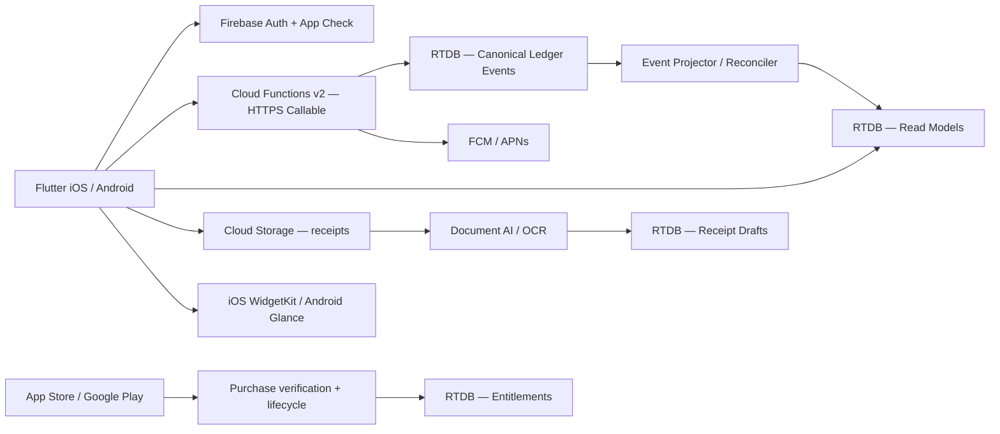

# Mây Family Finance — Technical Architecture v1.0

**Ngôn ngữ:** tiếng Việt. **Ngày:** 20/10/2026. **Trạng thái:** thiết kế đề xuất; chưa triển khai.

## 0. Mục tiêu và phạm vi
- Android + iOS; giao diện tinh gọn kiểu Apple, dùng chung Flutter/Dart.
- Sổ thu/chi gia đình, nhiều tài khoản, chuyển khoản nội bộ, tài sản/nợ, ngân sách, báo cáo theo tuần/tháng/năm.
- Quét hóa đơn bằng AI, luôn có bước xác nhận tay; nhập tay khi không có hóa đơn.
- Tiết kiệm, mục tiêu, danh mục đầu tư và so sánh quý/năm; cảnh báo không đạt mục tiêu với dữ liệu đủ tin cậy.
- Home widgets kéo thả + widget hệ điều hành; thông báo push và inbox, kiểm soát quyền riêng tư.
- Free có quảng cáo kín đáo; Mây Plus cá nhân không quảng cáo, **giá mục tiêu 19.000đ/tháng, 190.000đ/năm**. Giá thật lấy từ StoreKit/Google Play Billing theo khu vực.

### Ranh giới MVP
App theo dõi dữ liệu người dùng **tự nhập**. Chưa kết nối ngân hàng tự động, không chuyển tiền thật, không quản lý ví lưu ký. Không mặc định hiển thị lợi nhuận 'tự động' nếu không có dữ liệu giá/tài sản đủ tin cậy. Không khẳng định OCR đúng 100%.

## 1. Kiến trúc tổng thể

**Clients can read authorized projections.** All modifications to finance events, household memberships, budgets, assets and subscriptions pass through Cloud Functions. `Admin SDK` bypasses RTDB security rules, so each function validates Firebase Auth, App Check, household membership, role, request schema, monetary bounds and idempotency.

### Vì sao RTDB và giới hạn
RTDB phù hợp live sync đơn giản, nhưng thiếu compound queries và multi-node conditional transactions linh hoạt. Thiết kế v1: canonical financial event **một node bất biến**, các index/summary là projections có thể rebuild. Multi-location `update` hữu ích cho fan-out nhưng **không thay thế điều kiện giao dịch trên nhiều node**. Khi cần ledger giao dịch ngân hàng thực, nhiều loại tiền, hệ thống kế toán phức tạp, hãy chuyển canonical ledger sang Firestore transactional docs hoặc PostgreSQL, vẫn giữ RTDB cho live UI. Tránh dual-write hai database làm hai nguồn sự thật.

## 2. RTDB paths (đọc theo householdId)
| Path | Mục đích | Ghi | Đọc |
|---|---|---|---|
| `/users/{uid}` | profile/locale/defaultHousehold | Functions | Chủ sở hữu |
| `/userHouseholds/{uid}/{hid}` | index hộ gia đình | Functions | Chủ sở hữu |
| `/households/{hid}` | name, timezone, currency | Functions | Thành viên |
| `/members/{hid}/{uid}` | role, active, joinedAt | Functions | Thành viên |
| `/invites/{inviteId}` | mã mời băm/HMAC, expiresAt | Functions | Server/admin |
| `/accounts/{hid}/{accountId}` | tiền mặt/ngân hàng/tiết kiệm/đầu tư/thẻ nợ | Functions | Thành viên |
| `/categories/{hid}/{categoryId}` | nhóm thu/chi | Functions | Thành viên |
| `/ledgerEvents/{hid}/{eventId}` | **canonical append-only** | Functions | Chỉ lookup từng event ID |
| `/transactionList/{hid}/{YYYYMM}/{eventId}` | read model danh sách | Projector | Thành viên |
| `/accountMovements/{hid}/{accountId}/{YYYYMM}/{eventId}` | index giao dịch theo tài khoản | Projector | Thành viên |
| `/balanceSnapshots/{hid}/{accountId}/{YYYYMM}` | số dư kỳ + version | Projector | Thành viên |
| `/summaries/{hid}/{YYYYMM}` | thu/chi/danh mục, phiên bản tính toán | Projector | Thành viên |
| `/budgets/{hid}/{budgetId}` | kỳ hạn, threshold, categoryId | Functions | Thành viên |
| `/budgetStatus/{hid}/{budgetId}/{period}` | đã dùng, cảnh báo đã phát | Projector | Thành viên |
| `/assets/{hid}/{assetId}` | nhà, xe, vàng, bất động sản... | Functions | Thành viên |
| `/assetValuations/{hid}/{assetId}/{valuationId}` | lịch sử định giá và nguồn | Functions | Thành viên |
| `/investmentHoldings/{hid}/{holdingId}` | tài sản đầu tư, cost basis (nếu có) | Functions | Thành viên |
| `/investmentCashflows/{hid}/{holdingId}/{flowId}` | góp/rút/thu nhập | Functions | Thành viên |
| `/goals/{hid}/{goalId}` | mục tiêu tiết kiệm/đầu tư | Functions | Thành viên |
| `/growthInsights/{hid}/{period}` | đánh giá quý/năm, nguồn dữ liệu | Projector | Thành viên |
| `/receiptJobs/{hid}/{jobId}` | trạng thái OCR và bản nháp | Functions | Thành viên |
| `/notificationInbox/{uid}/{id}` | thông báo, deep link ID | Functions | Chủ sở hữu |
| `/notificationRead/{uid}/{id}` | đọc/chưa đọc | Chủ sở hữu | Chủ sở hữu |
| `/notificationSettings/{uid}` | categories, quiet hours, privacy | Functions | Chủ sở hữu |
| `/deviceTokens/{uid}/{deviceId}` | FCM token | Functions | Server |
| `/widgetLayouts/{hid}/{uid}` | vị trí/thứ tự/ẩn/hiện | Chủ sở hữu | Chủ sở hữu |
| `/widgetSnapshots/{uid}` | payload tối giản cho native widgets | Functions | Chủ sở hữu |
| `/entitlements/{uid}` | `no_ads`, trạng thái và ngày hết hạn | Verified billing handler | Chủ sở hữu |
| `/purchaseEvents/{provider}/{eventId}` | chống xử lý trùng webhook | Verified billing handler | Server |
| `/projectionCheckpoints/{hid}/{projection}/{eventId}` | dedupe / recovery | Projector | Server |
| `/auditLogs/{hid}/{auditId}` | actor, action, request/correlation ID | Functions | Admin/owner hoặc server |

**Không** đặt tất cả giao dịch lồng dưới `/households/{hid}`: RTDB download cả subtree khi đọc parent. Read model chia theo tháng cho giới hạn payload và phân trang.

### 2.1 Canonical ledger và tiền tệ
- `eventId` do client tạo UUID và tái sử dụng khi retry. Callable kiểm tra `fingerprint` trùng; **nếu trùng trả kết quả cũ**, không cộng tiền lần hai; khác payload thì 409.
- `amountMinor` nguyên dương theo số đơn vị nhỏ nhất của `currency`; VND có 0 chữ số thập phân. Server TypeScript kiểm tra `Number.isSafeInteger()` và > 0.
- `ledgerEvents` chứa postings cân bằng (`sum(deltaMinor) = 0`) theo từng currency. Ví dụ mua rau 185.000đ: asset cash `-185000` + nominal expense grocery `+185000`; chuyển bank→cash `-500000` và `+500000`.
- Entry bất biến; sửa/xóa bằng event `REVERSAL` và event mới, có `reversesEventId`; API không thực hiện `set()` đè bản gốc.
- Không được tính tiền chuyển giữa tài khoản là income/expense, và không tính cùng một event hai lần.
- Không lưu float tiền; có timezone, occurredAt epoch ms và periodKey tính ở backend theo timezone hộ gia đình. Xác định quy ước ngày khóa sổ.
- Tránh thực thi `increment` không có dedupe trong RTDB trigger. Use deterministic movement IDs, replayable projections, checkpoint + reconciliation. Projection có thể eventual consistent, UI hiện trạng thái đang đồng bộ nếu cần.
- Nếu hỗ trợ đa tiền tệ: **không cộng thẳng số dư hai đồng tiền**. Lưu original currency + FX snapshot theo thời điểm, báo cáo converted cùng với nguồn FX, có precision và trạng thái stale.

### 2.2 Aggregate / read model
- Giao dịch theo tháng: `/transactionList/{hid}/{YYYYMM}/{eventId}`; `.indexOn` cho `occurredAt`, `categoryId` nếu cần.
- Weekly/monthly/yearly reporting: tổng hợp từ monthly snapshots; week ISO hoặc locale được xác định rõ. Year = fold từ 12 tháng; quý = 3 tháng.
- `balanceSnapshots` xác định `asOfEventId`, `calculatedAt`, `version`, `status` (`READY | REBUILDING | STALE`).
- Recompute `netWorth = sum(signed liquid account balances) + sum(non-account asset latest valuations) - other liabilities`; tránh tính trùng holdings đã phản ánh trong investment account. `valuationSource`, `valuationAt`, `isEstimated` bắt buộc cho các asset định giá.
- Budget spending theo posted eligible expenses, excluding transfers/refunds xử lý theo chuẩn sản phẩm. Multiple notifications thresholds: 80%, 100%, 120%, mỗi kỳ/threshold một lần, dedupe key.
- Savings goal: `contributionProgress`; Investment performance: tiền lời/lỗ điều chỉnh dòng tiền và tách biệt `netContributions`. Chỉ tính rate khi có history đủ; tùy độ chi tiết dùng TWR hoặc Modified Dietz. Không gắn nhãn `không tăng trưởng` chỉ vì số dư không tăng nếu tài khoản có rút tiền.

## 3. Phân quyền RBAC
| Role | Xem | Tạo sửa giao dịch | Quản lý thành viên | Quản lý cài đặt hộ | Cài widget của mình |
|---|---|---|---|---|---|
| owner | tất cả shared | Có | Có | Có | Có |
| admin | tất cả shared | Có | Mời/thu hồi (không xóa owner) | Có | Có |
| editor | tất cả shared | Có | Không | Không | Có |
| viewer | tất cả shared | Không | Không | Không | Có |

MVP: mọi tài khoản trong household là shared, **không có privacy theo account**. Khi cần tài khoản cá nhân riêng, cho vào household riêng hoặc thiết kế ACL per-account và lọc projections từ server trước khi mở tính năng — không chỉ ẩn trong Flutter.

## 4. Luồng nghiệp vụ
### 4.1 Ghi chi tiêu bằng tay
1. Flutter validate input (UX). 2. `createLedgerEvent` callable validate lại Auth/App Check/role/schema. 3. `transaction` có điều kiện trên `/ledgerEvents/{hid}/{eventId}` (chỉ một immutable node). 4. RTDB trigger project danh sách + chuyển động tài khoản + snapshots. 5. Budget processor đánh giá threshold; notification outbox dedupes. 6. UI theo dõi read model. Khi retry nhận cùng eventId thì không nhân đôi.

### 4.2 Scan hóa đơn
1. Chụp ảnh → kiểm tra dung lượng/MIME, crop, nén; 2. `initReceiptUpload` tạo `jobId` và file path cố định. 3. Upload Cloud Storage private. 4. `parseReceipt` kiểm tra ownership, quét virus/metadata khi phù hợp, gọi OCR. 5. Lưu `receiptJobs` với `DRAFT` + confidence từng field. 6. Flutter review/edit merchant/date/amount/category/line items. 7. `confirmReceiptDraft` tạo ledger event idempotent, đánh dấu `CONFIRMED`. 8. Chính sách retention xóa ảnh gốc nếu người dùng không muốn giữ.

**Lưu ý:** Google Document AI Expense Parser được Google công bố danh sách ngôn ngữ cụ thể và tiếng Việt không được liệt kê; không mặc định dùng nó để cam kết quét hóa đơn tiếng Việt. Cần benchmark hóa đơn Việt Nam, có thể kết hợp OCR đa ngôn ngữ + parser riêng, luôn cho nhập tay.

### 4.3 Budget alert
`evaluateBudget` dựa trên canonical event đã được project; tạo dedupe ID `${budgetId}:${period}:${threshold}`; chỉ tạo `notificationInbox` một lần; dispatcher gửi FCM sau khi kiểm tra prefs/quiet hours. Với notification finance, mặc định lock screen chỉ hiển thị "Bạn có thông báo tài chính mới" trừ khi user bật hiện số tiền.

### 4.4 Investment stagnant growth
Theo quý/năm, xác định dữ liệu định giá đủ, loại net contribution; so sánh với target `minReturnBps` hoặc `minContributionMinor` theo loại mục tiêu. Nếu thiếu valuation/cashflow → ghi `INSUFFICIENT_DATA`, **không push cảnh báo kết luận âm tính**. Có snooze và quiet hours.

### 4.5 Subscription
Gói Plus chỉ mở `no_ads`, không chặn các tính năng quản lý tài chính thiết yếu. Giá mục tiêu 19.000đ/tháng và 190.000đ/năm ở VN, hiển thị giá **Store trả về** theo vùng. IAP client chỉ là khởi động giao dịch; backend xác thực với Apple/Google và subscribe server notifications, cấp quyền ở `/entitlements/{uid}`. Hỗ trợ restore, refund, grace, cancellation, expiry. Không cho Flutter tự ghi `isVip=true`. Quyền VIP mặc định theo **tài khoản người mua**, không tự động chia sẻ cả gia đình. Nếu cần family-share phải thêm chính sách Store và product model.

### 4.6 Widget
Trong app: các `WidgetDefinition` có `id, size, dataSource, scope, refreshPolicy`; thao tác reorder cập nhật `widgetLayouts/hid/uid`. Native: widget host nhận snapshot ít dữ liệu từ Flutter qua App Group (iOS) hoặc storage nội bộ an toàn (Android), cập nhật có giới hạn hệ điều hành; không kỳ vọng live từng mili giây, không expose thông tin nhạy cảm khi điện thoại khóa.

## 5. Non-functional requirements / SLO dự kiến
| Đặc tính | Mục tiêu / kiểm tra |
|---|---|
| Smooth UI | Target 60fps với thiết bị phổ biến; 120Hz khi hỗ trợ; đo profile mode |
| Home loading | Cache local trước, đồng bộ các projections nhỏ sau; tránh subscribe toàn cây |
| Reliability | At-least-once trigger, idempotent consumers, scheduled reconciliation và runbook replay |
| Offline | Read cache, pending local command được gắn idempotency ID; trạng thái pending rõ ràng |
| Data safety | Audit, soft correction, backup tự động, restore drill, export/delete user data |
| PII/security | Security Rules + App Check + backend RBAC, token secrets, no sensitive data in logs |
| Monitoring | Sentry/Crashlytics, structured JSON logs, trace IDs, latency/error dashboards |
| Cost | Alert billing quota, OCR per user quota, minInstances theo số liệu thực, retention ảnh |

## 6. Test strategy
- Unit: tiền tệ/int, postings sum-zero, chuyển khoản không tăng thu/chi, hiệu suất tài sản có dòng tiền.
- Emulator: Security Rules owner/admin/editor/viewer, client không ghi ledger/entitlements, index queries.
- Integration: cùng eventId gọi 10 lần vẫn tạo 1 event; projector duplicate/reordered deliveries, timeouts, retry OCR/FCM.
- E2E: scan→review→confirm, correction→reconcile, budget alert 80/100%, VIP buy→cancel/expire/refund→restore.
- Platform: widgets Android/iOS native, lock-screen redaction, app killed, deep link, notification permission denied.
- Security: cross-household access, account takeover, invite replay, forged purchases, malicious uploads, insufficient App Check.
- Operational: backup restore drills, reconciling mismatched daily aggregates, load tests by 100/1k concurrent families and read bandwidth.

## 7. Phân chia giai đoạn
**Phase 0** Firebase dev/staging/prod, CI, emulators, Auth, App Check, security, design tokens.
**Phase 1 — MVP:** household + member, cash/bank accounts, manual transactions, categories, budget, charts, data integrity, localized VND.
**Phase 2:** receipt OCR, notifications, configurable Home widgets.
**Phase 3:** savings, investments, valuations, net worth, performance + stale data handling.
**Phase 4:** VIP IAP, ads controls, Android/iOS system widgets, export/backup, accessibility and polish.
**Phase 5:** optional bank integrations, Firestore/PostgreSQL canonical ledger if transactional complexity warrants.

## 8. Các quyết định còn mở (ADR)
1. MVP single currency VND vs cho phép USD ngay từ đầu; đề xuất VND-first, chuẩn bị schema multi-currency.
2. Data sharing: household shared; optional personal accounts để phase sau.
3. Mây Plus per-user, không quảng cáo; năm 190k là giá dự kiến, phải cấu hình trong stores.
4. Bill OCR provider cần thử nghiệm với 200+ hóa đơn Việt Nam; không nên hứa accuracy khi chưa benchmark.
5. Không có realtime giá chứng khoán mặc định; user nhập valuation, độ mới phải hiển thị.

## Tài liệu chính thức được tham chiếu
- Firebase RTDB vs Firestore: https://firebase.google.com/docs/database/rtdb-vs-firestore
- RTDB structure: https://firebase.google.com/docs/database/web/structure-data
- RTDB security: https://firebase.google.com/docs/database/security
- RTDB admin write/transactions: https://firebase.google.com/docs/database/admin/save-data
- Firebase Functions v2: https://firebase.google.com/docs/functions/database-events
- Firebase idempotency: https://firebase.google.com/docs/functions/tips
- Document AI Expense parser: https://docs.cloud.google.com/document-ai/docs/processors-list
- Flutter Impeller: https://docs.flutter.dev/perf/impeller
- App Store review: https://developer.apple.com/app-store/review/guidelines/
