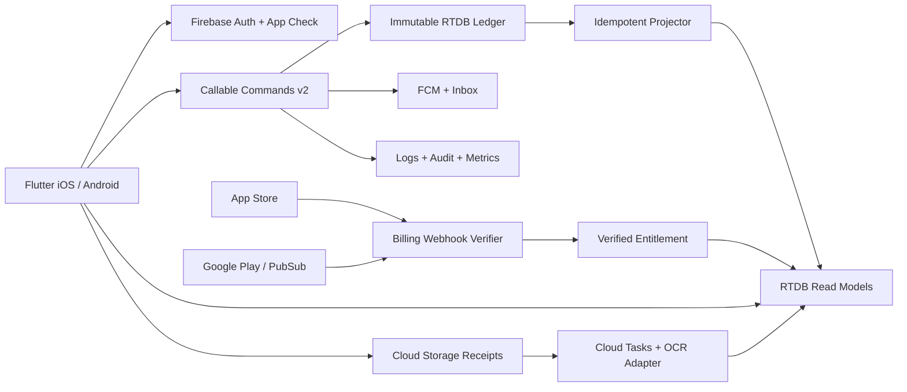

# 03 — Backend & Mobile Architecture

## System context


## Layers & boundaries
- **Flutter** UI, domain services and repos, command outbox, RTDB subscriptions for authorized read models; no Admin credentials, no server service account, no billing secrets.
- **Callable Functions** use Firebase Auth + App Check, Zod request validation, AuthorizationService, IdempotencyService, command handler and event repository; expected failure typed, logs sanitized.
- **RTDB canonical** LedgerEvent write-once. **Read models** `transactionList`, `accountMovements`, `budgetStatus`, `summaries`, `widgetSnapshots`, all rebuildable.
- **Cloud Tasks** async OCR, projection repair, batch reports, push sends, secure export, deletion.
- **Schedule** reminders, receipt cleanup, reconciliation, subscription backfill; jobs use scheduler + tenant paging and rate limits.
- **3rd integrations** behind interfaces `OcrProvider`, `BillingVerifier`, `PushProvider`, `PriceProvider` (MVP manual stub only), `AdService` (client).

## Repository layout
```text
repo/
  apps/mobile/{lib,android,ios,test,integration_test}
  functions/{src,test,package.json,tsconfig.json}
    src/{index.ts,common,auth,household,accounts,ledger,budgets,analytics,assets,receipts,widgets,notifications,purchases,maintenance}
  packages/contracts/{src,schemas}
  firebase/{database.rules.json,storage.rules,emulator-fixtures}
  infra/{firebase.json,firebaserc,config.example.json}
  docs/{architecture,security,runbooks,adrs}
  .github/workflows/{validate.yml,release.yml}
```

## Ledger canonical commit sequence (MVP)
1. Client generates UUID `clientRequestId`, stable across retries; prevents rapid double submit with UI guard. Normalize request and server computes stable payload fingerprint.
2. Callable `createLedgerEvent` verifies Auth/App Check/member/role/account ownership/id/amount bounds, and posts balanced lines to canonical event. Use RTDB `transaction()` at deterministic **event key** (e.g. event ID derived/associated with caller + request ID) to create only if absent; duplicate same fingerprint returns original, mismatched fingerprint fails. In `transaction` callback, no side effects or network calls.
3. A trusted trigger reads event, recomputes deterministic projections or schedules serialized projection tasks; checkpoint records processed event identity/hash and projection algorithm version. **Do not `increment` balances from at-least-once trigger without atomic dedupe.**
4. Because RTDB cannot atomically *compare-and-swap multiple arbitrary nodes*, projection processing should use a per-household/account partition lock/transaction plus deterministic read-model writes, or rebuild materialized period state from canonical events and atomically replace affected summary nodes. Checkpoint and output should be committed together in one **atomic multi-location update after serialization**, and retried deterministically; reconciliation repairs interrupted or stale runs.
5. Response `status:accepted`, event ID; UI displays `Đang đồng bộ` until read-model version catches up. If transient projector failure, recover by scheduled reconciliation.
6. Mutation `correctLedgerEvent` creates reversal + replacement as an orchestrated command under a reservation/operation lock, track operation status, reconcile interrupted steps, never silently claim atomicity across separate event creations.

**Important:** A ledger implemented solely as separate RTDB node transactions is **not strong ACID across multiple independent records**. For complex high-concurrency financial workflows, consider Firestore transaction or PostgreSQL canonical DB. Mây v1 is household budgeting, not money movement or a regulated ledger.

## Projection design
- `transactionList/{hid}/{YYYYMM}/{eventId}` contains denormalized projected state (kind, account, category, amount, status, title, postedAt, eventId), bounded page read.
- `accountMovements/{hid}/{accountId}/{YYYYMM}/{eventId}` sorted by `occurredAtMs`, includes reversal flag. `balanceSnapshots` include `asOfEventId`, `builtAt`, `projectionVersion`, status `READY|STALE`.
- `summaries/{hid}/{YYYYMM}` carries `incomeMinor`, `expenseMinor`, `byCategory`, `startAt`, `endAt`, `currency`, `projectionVersion`, `reconciledAt`. Weekly/yearly aggregation combine month read models or use precomputed partitions; never silently merge distinct currencies.
- `budgetStatus/{hid}/{budgetId}/{periodKey}` uses active posted expenses per matching categories and target period; threshold crossing event deterministic key.
- `netWorthSnapshots/{hid}/{YYYYMM}` prevents duplicate holdings/accounts via `valuationSubjectId`, maps liabilities as subtraction, includes estimation and stale flags.

## Offline-first strategy
- Local encrypted/sensitive storage for pending **drafts and command outbox**; RTDB SDK offline cache is not authoritative permission control.
- Each outgoing command status: `DRAFT → QUEUED → SENDING → ACCEPTED → PROJECTED` or `FAILED_RETRYABLE/FAILED_FINAL`. Server dedupe ID stable; exponential backoff + jitter; manual retry on user demand.
- On sign-out/revocation wipe per-tenant caches, local widget snapshots & pending notifications. Disallow finance edit while removed from household. Avoid pretending to POST when offline.

## Consistency and period rules
- ISO 4217 code per event and account, integer money minor amount; do not store float.
- `occurredAtMs` user date; `createdAtMs` server time; `periodKey` computed server using household timezone (default Asia/Ho_Chi_Minh). DST and daylight boundary tests required.
- No arbitrary currency conversion in MVP. If multi-currency in future, use decimal-safe FX service, rate source/time, reversal/FX realized gains rules.
- Investment return must not be inferred from raw balance delta. Use XIRR (money-weighted) or time-weighted when cashflows and valuations are sufficiently complete; show source, horizon, method and insufficiency state.

## Security boundaries
- Client can directly **read** narrow, authorized RTDB projections, plus own notification & widget prefs; direct writes strictly limited to harmless personal presentation state where explicitly allowed.
- Financial commands and membership changes only trusted functions; Admin SDK bypasses RTDB rules, so explicit authorize() on every handler.
- Billing webhooks: validate signed Apple JWS/Google Pub/Sub authenticity, query subscription status from authoritative store, bind purchase to UID securely, dedupe with event IDs, no client override.
- Receipt images private to household/creator with Storage Rules + server-side access checks for OCR and downloads; limit size and type, enable malware/content validation when needed.

## Operational strategy
- Environment separation: `may-dev`, `may-staging`, `may-prod`; distinct store sandbox credentials and databases, strict least-privilege IAM.
- Build/release config uses secret manager, never checked-in secrets; firebase emulator for integration tests.
- Structured logs carry `correlationId`, `function`, `householdId` pseudonymous hash, `outcome`, `latencyMs`; **not** amount, account number, receipt text, names or tokens.
- Metrics: command error rate/p95, projector lag, reconciliation mismatch, OCR error rates/latency/cost, FCM sends, webhook verification latency, purchases pending, function cold starts and RTDB egress.
- Backups: RTDB export/restore versioned and encrypted; routine restore drill; separate immutable audit evidence with retention policy; disaster recovery RPO/RTO defined before paid launch.
- Firebase project cost budgets and alarms; app function region configured near deployment-supported RTDB region to avoid egress/latency.

## Deployment and rollback
Use GitHub Actions with signed CI artifacts, pinned SDK dependencies, environment approval for prod; `flutter analyze`, `dart test`, functions lint/typecheck/unit, emulator integration, rules tests, dependency/secret scans. Deploy rules before backend only when backward compatible; use additive schema changes and projection version migration. Canary functions by region/feature flags, rollback code and re-run projector reconciliation; never delete canonical ledger on rollback.
