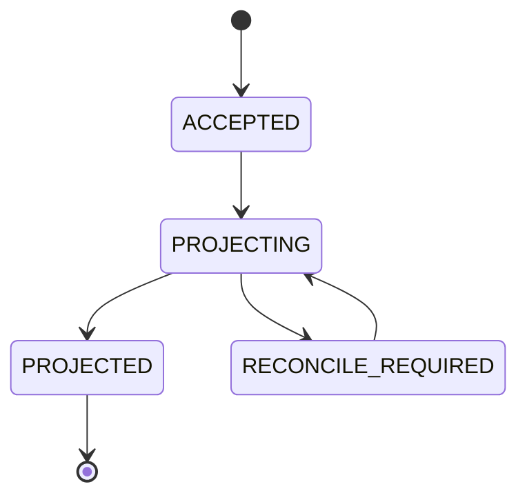
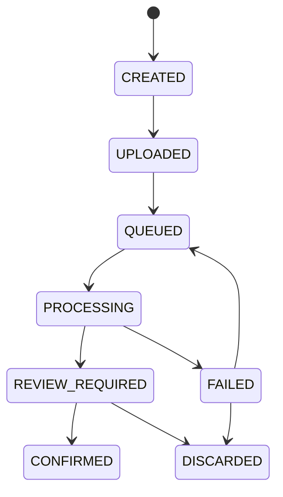

# 06 — Callable/API Contracts, Errors & Events

## Transport
- Mobile command endpoints use Firebase **Callable Functions v2** (`https.onCall`) with Firebase Auth and App Check enabled, DTO validated by Zod. Do not expose raw public unauthenticated REST for financial writes.
- Billing ingress is separate HTTPS endpoint (Apple signedPayload webhook) or authenticated Google Pub/Sub push; always verify signed requests/event authenticity; **never trust webhook body without re-fetch/verification**.
- Server responses typed; business error represented by typed `HttpsError` for callable with safe messages and stable `details.code`.

## Request / response envelope
```ts
export type CommandMeta = {
  householdId: string;
  clientRequestId: string;       // UUID v4, stable over retries
  schemaVersion: 1;
};
export type AcceptedCommand = {
  requestId: string;
  resourceId: string;
  status: 'ACCEPTED' | 'PROJECTED';
  acceptedAtMs: number;
  projectionVersion?: number;
};
export type ApiErrorDetail = {
  code: 'VALIDATION_ERROR' | 'HOUSEHOLD_ACCESS_DENIED' | 'ROLE_DENIED' |
        'ACCOUNT_NOT_FOUND' | 'CURRENCY_MISMATCH' | 'DUPLICATE_CONFLICT' |
        'ALREADY_REVERSED' | 'RECEIPT_NOT_READY' | 'PURCHASE_UNVERIFIED' |
        'RATE_LIMITED' | 'TEMPORARY_UNAVAILABLE' | 'INVARIANT_FAILED';
  correlationId: string;
  fieldErrors?: Record<string,string>;
  retryable: boolean;
};
```

## Example `createLedgerEvent`
```json
{
  "householdId": "hh_01",
  "clientRequestId": "90351d7b-286c-4da2-a208-883e2a7c44c8",
  "schemaVersion": 1,
  "kind": "EXPENSE",
  "accountId": "acc_cash",
  "categoryId": "cat_food",
  "amountMinor": 185000,
  "currency": "VND",
  "occurredAtMs": 1792440000000,
  "note": "Đi chợ"
}
```
**Server flow**: auth+app check -> role -> validate linked account/category within household -> ensure safe integer/accepted currency -> canonical normalized fingerprint -> conditional create event at deterministic key -> return `ACCEPTED` -> projection eventual consistency. `TRANSFER` requires fromAccountId/toAccountId; no category. `INCOME` may use income category and positive receiving account posting. Input `actorUid` is prohibited; actor from Auth.

## Example `confirmReceiptDraft`
```json
{
  "householdId":"hh_01",
  "clientRequestId":"ae4d5896-8dbf-4d4f-979c-bb9b5289aeda",
  "schemaVersion":1,
  "jobId":"receipt_01",
  "reviewed":true,
  "merchant":"Cửa hàng A",
  "occurredAtMs":1792440000000,
  "accountId":"acc_cash",
  "categoryId":"cat_food",
  "totalMinor":185000,
  "currency":"VND"
}
```
Must verify job ownership, status `REVIEW_REQUIRED`, bind once to resulting LedgerEvent via idempotency, never directly post draft extraction without review.

## Example notification / widget read-model DTO
```ts
export interface NotificationInboxItem {
  id: string; type: 'BUDGET'|'BILL_DUE'|'GOAL'|'GROWTH'|'WEEKLY';
  createdAtMs: number; title: string; bodySafe: string;
  deepLink: { route: string; householdId?: string; resourceId?: string };
  readAtMs?: number;
}
export interface WidgetLayout {
  revision: number; items: Array<{
    id: string; type: 'NET_WORTH'|'INCOME'|'EXPENSE'|'BUDGET'|'CATEGORIES'|
      'SAVINGS'|'INVESTMENT'|'GOALS'|'RECENT_TRANSACTIONS';
    size: 'SMALL'|'WIDE'; order: number; visible: boolean;
  }>;
}
```

## Error semantics
| Callable HttpsError | Detail code | Client action |
|---|---|---|
| unauthenticated | `AUTH_REQUIRED` | re-login; retain safe draft |
| permission-denied | `HOUSEHOLD_ACCESS_DENIED`, `ROLE_DENIED` | dismiss/private fallback, purge tenant local cache |
| invalid-argument | `VALIDATION_ERROR` | inline specific fields |
| failed-precondition | `ALREADY_REVERSED`, `RECEIPT_NOT_READY`, `CURRENCY_MISMATCH` | show clear resolution |
| already-exists | `DUPLICATE_CONFLICT` | show conflict, do not retry with altered payload using same key |
| resource-exhausted | `RATE_LIMITED` | wait/backoff/jitter; manual retry |
| unavailable | `TEMPORARY_UNAVAILABLE` | keep queued, exponential retry |
| internal | `INVARIANT_FAILED` or sanitized internal error | incident log corrId, no sensitive detail |

## API authorization matrix
- Query `GET` read models in RTDB: member ACTIVE for matching tenant, per-user notifications only self, entitlements self.
- `create*`/`update*` transaction, account, budget, assets: OWNER/ADMIN/EDITOR. VIEWER read only.
- Household member invite/change/remove: OWNER/ADMIN constrained; ownership transfer OWNER only; last OWNER protected.
- `verifyStorePurchase`: authenticated UID with store proof; store transaction must be cryptographically/authoritatively verified + bound to UID.
- Signed billing webhook: no Firebase user auth; provider authenticity and subscription verification required, unknown users pending reconciliation.
- Scheduler/task: service account IAM restricted, processing code validates task payload tenant IDs and idempotency.
- `saveWidgetLayout`, `updateNotificationSettings`, `registerDeviceToken`: self + active membership where relevant.

## Idempotency details
- ClientRequestId uniqueness scoped to `{householdId}/{uid}` and reserved prior to side effects. Response stored/derivable; same key + same canonical request returns same resource ID; different request returns stable `DUPLICATE_CONFLICT`.
- For systems with multistep side effects (OTP/invites/mutations) persist `operationId` with state, use monotonic step transitions. Do not create arbitrary retry loops in transactional callbacks.
- Receipt `confirmReceiptDraft` must bind only one ledger event even if twice submitted from two devices. Store-event dedupe keys: Apple `notificationUUID` plus transaction identity; Google Pub/Sub `messageId` + purchaseToken and order information.
- FCM alert deterministic ID `uid:hid:budgetId:period:threshold` persisted before dispatch; transient send failure retriable without generating 2 inbox entries.

## Event state machines




## Versioning, compatibility, limits
- Each request has `schemaVersion`; support v1 and reject future unknown versions with explicit client upgrade requirements.
- Request input maximum: merchant < 200 chars, note < 500, user display name < 100, category < 60, asset name < 120, widgets <= 30, batch list <= 100.
- Amount bounds and asset max must be set after finance domain tests; default `Number.isSafeInteger`, positive/finite; reject NaN, Infinity, negative where not allowed, unsupported currency, extremely old/future dates.
- RTDB path keys sanitized/validated; prevent prototype pollution/unexpected keys in external JSON; `strict()` schemas in Zod.
- Response never contains secure receipt download token in public log, raw billing token or FCM token.

## Generated contracts guidance
The accompanying `contracts/domain-contracts.ts` is a **reference DTO** to implement/extend in a shared package. It does not imply backend/mobile compiled code or deployed callable endpoints. Generate Dart equivalent from schemas or create manual typed model tests; no divergent handwritten finance math on clients.
